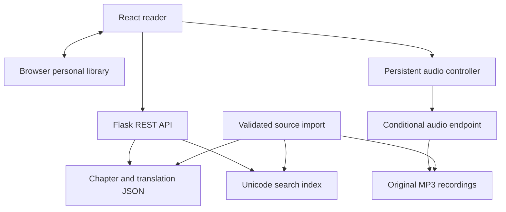

# Gita Path — Read. Listen. Reflect.

A complete, independently runnable Bhagavad Gita reading and listening project built with **React + JavaScript + Vite** and **Flask + Waitress**. It uses normal npm and Python packages. There is no hosted builder SDK, remote scripture API, AI provider, account requirement or proprietary backend dependency.

Start with **[START_HERE.md](START_HERE.md)**. The distribution includes `frontend/dist`, so the normal server can run with Python alone:

```sh
python setup_project.py
python run.py
```

Open http://127.0.0.1:5000. Developer setup and the two-service launcher are documented in START_HERE.

## Features

| Module           | Implemented behaviour                                                                                                                                                                                  |
| ---------------- | ------------------------------------------------------------------------------------------------------------------------------------------------------------------------------------------------------ |
| Chapter library  | All 18 chapters, Sanskrit and English names, summaries, chapter filtering, progress and resume                                                                                                         |
| Reader           | Whole-chapter and single-verse views, deep links, desktop chapter rail and mobile navigation drawer, previous/next across boundaries, keyboard arrows in the reading area, adjustable text and spacing, focus/fullscreen layout |
| Languages        | Sanskrit, Roman transliteration, word meanings, English/Hindi/both, five English and two Hindi translators                                                                                             |
| Commentary       | On-demand English/Hindi commentary with author selection                                                                                                                                               |
| Listening        | Sanskrit, Hindi and English MP3 narration with a language switch (or Sanskrit → Hindi → English in one go), persistent player, play/pause, seek, speed, volume, repeat, continuous playback and chapter-stop/continue options                                                             |
| Search           | Flask search across Sanskrit, transliteration and all seven translations; references such as `2.47`; language/chapter filters and pagination                                                           |
| Personal library | Bookmarks, notes, read marks, recent verses, resume, validated backup download/restore with replacement confirmation                                                                                   |
| Appearance       | Paper/light/dark themes across the app, responsive layouts, bundled Devanagari/serif fonts, labelled controls and reduced-motion support                                                               |

## Architecture



The frontend is authored entirely in `.js` and `.jsx` files. The frontend uses relative `/api` requests. Vite proxies them to Flask in development; in normal mode Flask serves both the built frontend and the API from one origin. Waitress serves the WSGI app. Personal data stays in browser localStorage and is never posted to the backend.

## Project structure

```text
backend/
  app.py, catalog.py, server.py    API, data access/search, WSGI entry point
  data/                          chapter JSON, commentary, search index, manifest
  media/audio/<chapter>/<verse>.mp3
  tests/                         corpus, API and live Waitress tests
frontend/
  src/                           React pages, reader, player, settings and store
  public/                        native SVG favicon
  dist/                          ready-to-run production frontend
  package.json, package-lock.json
scripts/import_data.py           reproducible source import
docs/API.md                      endpoint reference
run.py, setup_project.py          cross-platform launch/setup
check_project.py                 tests and production build
PROJECT_REPORT.md                academic report
```

## Dataset and reproducibility

The provided `gita-main.zip` is the content source. The importer reads only `data/chapters.json`, `verse.json`, `translation.json`, `commentary.json`, and `data/verse_recitation`. It never uses the archive's alternate/generated translation files.

Translations join through **`translation.verse_id → verse.id`**. IDs are not confused with per-chapter verse numbers. The edition has **701** records: Chapter 13 has 35 verses and includes Arjuna's opening question. Sanskrit wording and all source MP3 bytes are retained; whitespace and leading translation reference markers are normalised for display.

To rebuild the data from the original ZIP or extracted repository:

```sh
python scripts/import_data.py --source /path/to/gita-main.zip
python scripts/import_gita_zip.py --source /path/to/gita.zip   # Sanskrit fixes + sa/hi/en audio (needs ffmpeg)
```

Import assertions cover unique IDs/references, exact chapter counts, nonempty Sanskrit, all seven translations per verse, dangling joins and MP3 presence. `backend/data/import_manifest.json` records the source archive SHA256 and every audio checksum. Two source files (5.27 and 5.28) share identical audio bytes; the supplied files are preserved without claiming that these are distinct recordings.

## Verification

Install developer requirements and run:

```sh
python setup_project.py --dev
python check_project.py
```

The checker runs backend tests, frontend unit/interaction tests, JavaScript linting and the production build. It writes actual outcomes to `TEST_RESULTS.json`.

Backend tests validate all 701 audio checksums, translation coverage, reference handling, Unicode search, pagination, conditional caching, real HTTP audio range requests, unknown routes and SPA hosting. React interaction tests exercise deep links, bookmarks, notes, translations/themes, player persistence, search navigation, and valid/cancelled/malformed backup uploads. Audio is simulated in component tests; HTTP streaming is tested against actual Waitress.

The build was checked on Linux using Python 3.12 and Node.js 24. The launchers use Windows-compatible paths and Waitress, but a Windows desktop was not available for execution. Real-browser visual checks are not included in the automated test results.

## Deployment

Run the regular server behind an HTTPS reverse proxy. Configure `GITA_HOST=0.0.0.0` and `PORT` for a container/platform, or pass `--host`/`--port`. There is no database migration or secret-key setup.

A multistage Dockerfile is included:

```sh
docker build -t gita-path .
docker run --rm -p 5000:5000 gita-path
```

The Docker configuration is supplied for deployment; container execution is not part of the recorded checks. Serve only the app's HTTP endpoints, not the project directory as a generic file share.

## Scope and credits

- Notes and progress are local to a browser; there is no login or cross-device sync service.
- Audio covers Sanskrit recitation plus Hindi (Swami Tejomayananda) and English (Shri Purohit Swami) narration, from the supplied `gita.zip`; narration was matched to those translators by length analysis, not transcription. The original slow Sanskrit chant is kept as an extra track. Recordings retain their owners' rights.
- Only Hindi and English source commentaries are displayed.
- The app is a study companion, not an authoritative adjudication between traditions or translators.
- Source software licence, font licences and attribution are under `licenses/`. Dataset translations/recordings retain their respective owners' rights.

JavaScript quality checks: `npm run lint`, `npm test`, and `npm run build` inside `frontend`. No compiler configuration or typed source files are required.

Technical references: [Flask API](https://flask.palletsprojects.com/en/stable/api/), [Flask/Waitress deployment](https://flask.palletsprojects.com/en/stable/deploying/waitress/), [Vite guide](https://vite.dev/guide/), [React](https://react.dev/).


## Accounts, daily e-mail and thought of the day

* The app opens with a **log-in / sign-up page** (with a Show password button). Sign-up e-mails a 6-digit code to
  confirm the address is real; only then can the person enter.
* The strip at the top shows **Users joined : N** (verified readers; the administrator is not counted).
* Every verified user gets a **daily e-mail** with the verse of the day (Sanskrit, English, Hindi) and the current
  thought of the day. Users can switch it off in their account or with the link in the e-mail.
* The administrator (set with `GITA_ADMIN_EMAIL` / `GITA_ADMIN_PASSWORD`) opens **Account > Write the thought of the
  day** (`/admin`). The newest message appears in its own section on the home page, like the verse of the day.
* Settings go in a `.env` file (copy `.env.example`). Without SMTP settings, e-mails are printed in the terminal, so
  everything can be tried on a computer first. Data is kept in a local SQLite file, or in a hosted PostgreSQL database when `DATABASE_URL` is set (needed on free hosts). Deployment, including a fully free setup: [docs/DEPLOYMENT.md](docs/DEPLOYMENT.md).
